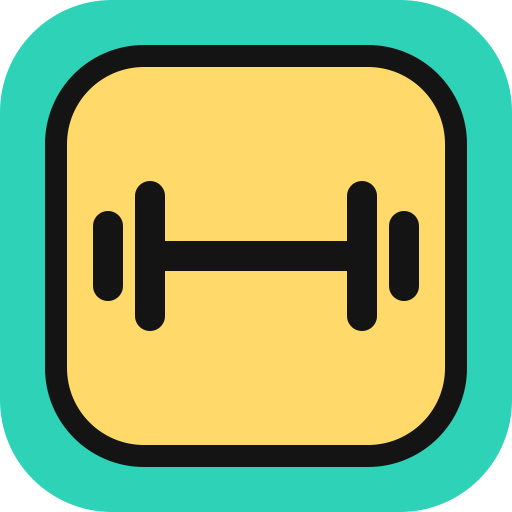
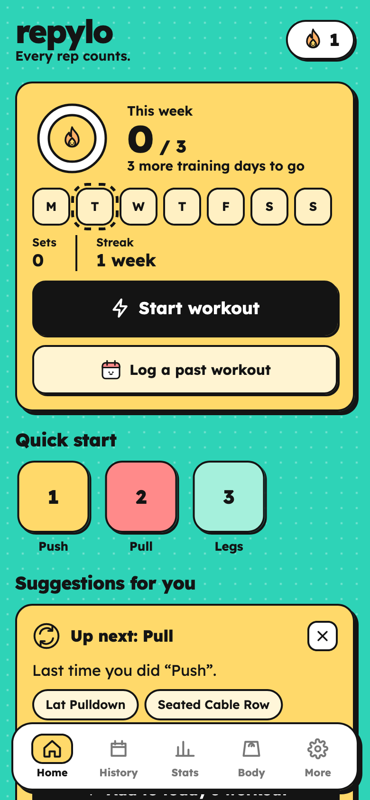
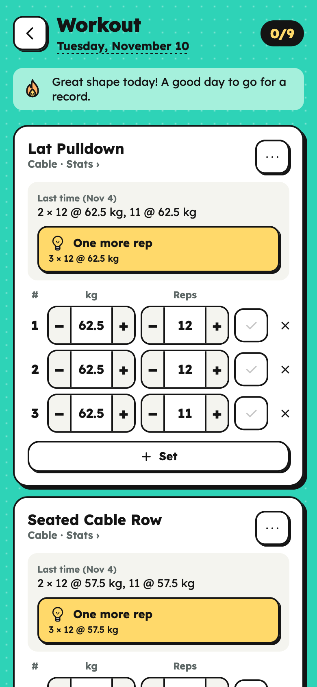
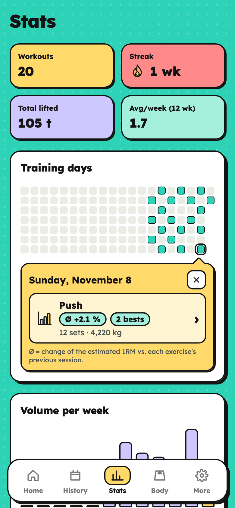
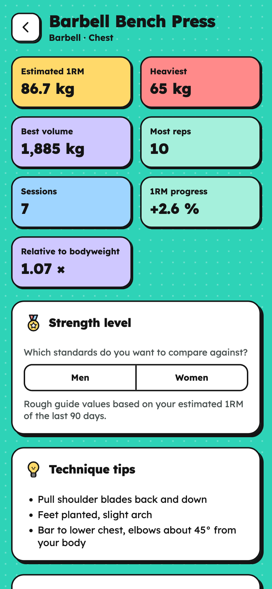

<p align="center">
  
</p>

<h1 align="center">repylo</h1>
<p align="center"><strong>Every rep counts.</strong><br />A colourful, local-first workout tracker – no account, no backend, your data stays on your devices.</p>

<p align="center">
  
  
  
  
</p>

## What it does

repylo is a Progressive Web App for logging strength training – free weights, machines, EGYM circuits, bodyweight and cardio – that acts a bit like a personal coach. Everything is computed on the device from your own history; there is no AI service and no server that sees your workouts.

**Logging**

- Start today's workout or log a past one; copy any earlier workout or a template (split)
- 140+ exercises with primary/secondary muscles, filterable by equipment and muscle, plus custom exercises
- Weight × reps, bodyweight (+ added weight), time and distance; −/+ steppers, rest timer, plate calculator
- Starting values for never-done exercises, estimated from your strength on similar exercises

**Coaching**

- Double progression per goal (strength 3–6, hypertrophy 8–12, endurance 15–20 reps), deloads when performance drops
- Feedback after every set ("+2 reps vs. last time – next set: 10 × 62.5 kg") and a summary after each workout
- Suggestion cards: next split, neglected muscle groups, exercises you dropped, push/pull and quad/hamstring balance, plateaus with variants, planned deload weeks – respecting 48 h recovery
- Readiness check (sleep, energy) that lightens suggestions on a bad day
- Plan assistant: split or circuit for 2–6 days a week, at the gym, on EGYM machines or at home
- Technique tips for the most common exercises

**Insights**

- Estimated 1RM, records per rep count, progress charts and sparklines, strength level relative to body weight
- Heatmap, weekly volume, sets per muscle group vs. target, body weight trend
- Monthly review, shareable as an image

**No account**

- Data lives in an encrypted SQLite database in the browser and works fully offline
- Devices pair by scanning a QR code; sync is end-to-end encrypted via a relay that only sees ciphertext
- German and English, kg and lbs, JSON export/import

## How it works

```
src/
  domain/     Pure logic, no UI: exercises, stats, progression, suggestions,
              coach, planner, estimates, standards, review – each with tests
  db/         Evolu schema and queries, write actions, device identity, backup, demo data
  ui/         App/feedback context, shared components, stickers, date field, install prompt
  screens/    home/, workout/, stats/, settings/ and the smaller screens
  test/       Fixtures for building readable training histories in tests
public/       Icons and the boot watchdog (plain JS, shown if the app fails to start)
```

- **Local-first storage and sync** – [Evolu](https://www.evolu.dev) provides SQLite (WASM, OPFS) in the browser, CRDT-based merging and end-to-end encrypted sync. A device's identity is a 24-word phrase; the pairing QR code is a link that carries it in the URL fragment, which never reaches a server.
- **Load once, derive everything** – the app loads all rows and computes statistics with pure functions. Training logs are small, and plain functions over arrays are easy to test and reason about.
- **History is relative** – "last time", progression and records always look at workouts _before_ the one being edited, so backfilled workouts are judged against their own past.
- **Rules, not a model** – every suggestion is a small, documented rule in `src/domain`, with tests describing the expected behaviour.
- **Accountless by design** – no telemetry beyond an anonymous, cookie-free visit counter (GoatCounter) that never sees workout data.

## Development

```bash
npm install
npm run dev        # dev server
npm run check      # types, lint, formatting, tests
npm run build      # production build with service worker
npm run preview    # try the build locally
```

Open the app with `#demo` in the URL (e.g. `http://localhost:4173/#demo`) and reload to load six weeks of example training.

> In the Claude desktop app's built-in browser, module SharedWorkers with imports don't load; use `npm run build && npm run preview` there. Regular browsers are not affected.

## Deployment

repylo is a static site (Netlify, Cloudflare Pages, GitHub Pages, …). Build with `npm run build` and serve `dist/`.

Sync uses Evolu's free test relay by default. For real use, [host your own relay](https://www.evolu.dev/docs/relay) and set `VITE_RELAY_URL` at build time (one or more comma-separated `wss://` URLs). Devices keep a full copy of their data, so switching relays loses nothing.

## Tech

React 19 · TypeScript (strict) · Vite · Evolu · vite-plugin-pwa · Vitest · oxlint · Prettier
